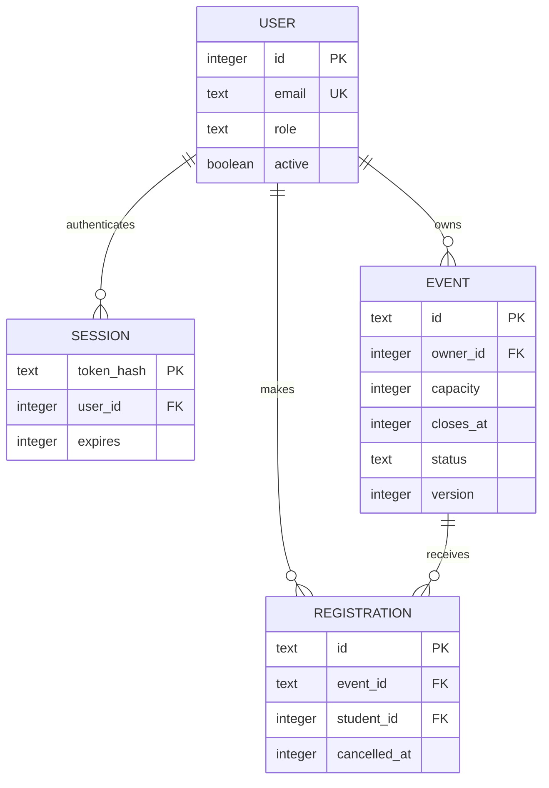
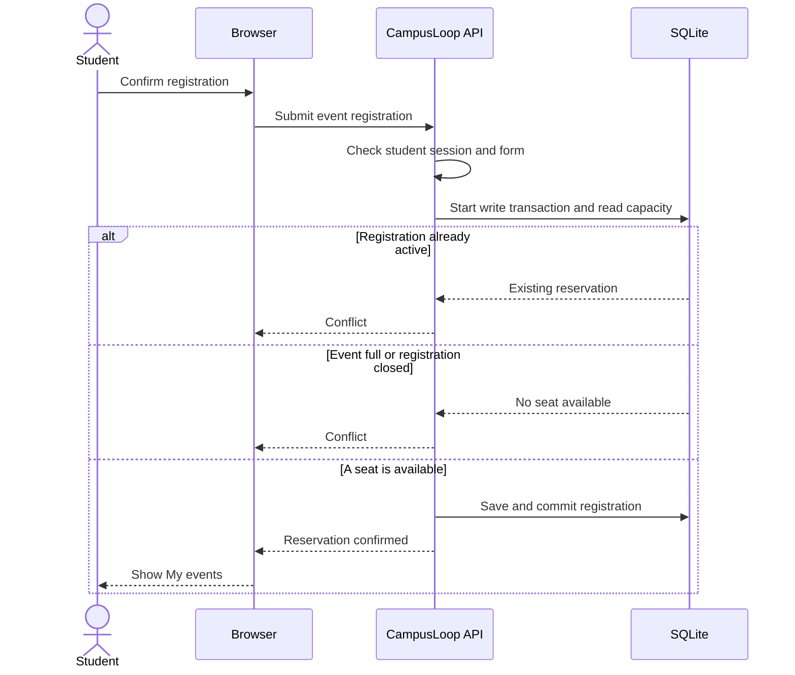

# CampusLoop

**A university event portal for discovering what’s on, registering for a seat, and running campus events.**

[Run CampusLoop](#run-campusloop) · [Try the workflows](#try-the-workflows) · [Architecture](#architecture) · [Team ownership](#team-ownership) · [Verify and deploy](#verify-and-deploy)

CampusLoop serves one university campus. Students browse events and manage their own registrations. Approved clubs, societies, and departments publish events, manage capacity, and view their own attendee lists.

| View | What you can do |
| --- | --- |
| **Home and Explore** | Find upcoming events by keyword, category, availability, and sort order. |
| **Event details** | Check venue, schedule, eligibility, deadline, and available seats before registering. |
| **My events** | See confirmed and previous registrations, then cancel an upcoming reservation when permitted. |
| **Organizer studio** | Save drafts, publish, edit upcoming events, cancel, archive, and view attendees for owned events. |

<details>
<summary><strong>See the campus artwork</strong></summary>


</details>

## Run CampusLoop

Use Python 3.12 or newer. From the repository root:

```sh
python3 -m venv .venv
. .venv/bin/activate
python -m pip install -r requirements.txt
python -m campusloop seed-demo
python -m campusloop serve
```

Open [http://127.0.0.1:8000](http://127.0.0.1:8000) and select **Sign in**. Use the exact address with the default local setup.

<details>
<summary><strong>Windows PowerShell setup</strong></summary>

```powershell
py -m venv .venv
.\.venv\Scripts\Activate.ps1
python -m pip install -r requirements.txt
python -m campusloop seed-demo
python -m campusloop serve
```

</details>

<details>
<summary><strong>Local demo accounts</strong></summary>

| Sign-in | Fictional email | First destination |
| --- | --- | --- |
| Student | `student@campusloop.example` | My events, or the event you were registering for |
| Organisation | `organizer@campusloop.example` | Organizer studio |

Both accounts use `CampusLoop-Demo-2026`. The opt-in seed command creates 12 fictional events and keeps existing rows when rerun. Start with a new development database path to reset the demo.

</details>

<details>
<summary><strong>Build the standalone phone-friendly preview</strong></summary>

After installing the dependencies, generate the standalone file:

```sh
python -m review.build CampusLoop-Review.html
```

Open the generated HTML in Chrome and use **Try student** or **Try organizer**. Viewers with scripting disabled can still expand sample event details and read both walkthroughs. Interactive edits stay in the browser tab until reload. Use the shared-database app above to verify persistence across tabs.

</details>

## Try the workflows

<details open>
<summary><strong>Student walkthrough</strong></summary>

1. Open **Explore** and search for **Design Lab: Figma 101**.
2. Open the event and check its venue, deadline, eligibility, and seats.
3. Select **Sign in to register**, use the student demo account, and confirm a registration with a department and year.
4. Open **My events** and reload the page to check that the reservation persists.
5. Cancel the reservation and confirm it moves into **Past and cancelled**.

</details>

<details>
<summary><strong>Organisation walkthrough</strong></summary>

1. Select **Organisation sign-in** and open **Organizer studio**.
2. Create an event with a future start and registration deadline, then save it as a **Draft**.
3. Edit the draft and select **Publish event**. Confirm the listing appears in **Explore**.
4. Open **Attendees** after a student registers to check the event's roster.
5. Cancel a future event, then archive it. The attendee history remains available to the organiser.

</details>

<details>
<summary><strong>Check the role boundary</strong></summary>

- Use valid student demo credentials on the organisation sign-in screen to see the role check.
- Open a draft as its organiser, then check the same event link in a signed-out window.
- Use the regression suite below to check that concurrent requests for the last seat yield one reservation.

</details>

## Architecture

The browser renders HTML, CSS, and vanilla JavaScript. FastAPI serves those files and exposes a same-origin JSON API. SQLite persists accounts, sessions, events, and registrations. Each event belongs to one organiser account. A student has at most one registration record per event.

<details open>
<summary><strong>Data relationships</strong></summary>



</details>

<details>
<summary><strong>How registration handles duplicate requests and full events</strong></summary>



SQLite serialises the seat check and write. The cancellation request carries the displayed registration ID so an old tab cannot cancel a later booking.

</details>

<details>
<summary><strong>API and source map</strong></summary>

| Area | Route family | Implementation |
| --- | --- | --- |
| Discovery | `GET /api/events` and `GET /api/events/{event_id}` | [API](campusloop/app.py) · [Explorer UI](campusloop/static/app.js) |
| Account access | `GET / POST / DELETE /api/session` | [Session policy](campusloop/security.py) · [Input validation](campusloop/models.py) |
| Student workspace | `/api/my-events` and `/api/events/{event_id}/registration` | [API](campusloop/app.py) · [Database constraints](campusloop/db.py) |
| Organisation workspace | `/api/organizer/events` and per-event actions | [API](campusloop/app.py) · [Organiser UI](campusloop/static/app.js) |
| Review | Standalone HTML build | [Builder](review/build.py) · [Demo adapter](review/adapter.js) |
| Operations | `GET /healthz` and account and backup commands | [CLI](campusloop/__main__.py) · [Deployment](DEPLOYMENT.md) |

The application uses roles and event ownership on the server, scrypt password hashes, expiring session-token digests, and same-origin checks for write requests. Event times display in **Asia/Kolkata**.

</details>

## Team ownership

Each person owns a complete web-development slice with browser work, server work, and an acceptance test. The first PRs below are **assigned work**. Use the [merged pull requests](https://github.com/Abhi-1808/Campus_loop/pulls?q=is%3Apr+is%3Amerged) to track completed contributions.

| Teammate | Owns | Browser work | Server work |
| --- | --- | --- | --- |
| **Abhishek Arya** | Account access and release integration | Sign-in, role prompts, and session-expiry recovery | Session behaviour, safe return paths, and integration checks |
| **Niddhi** | Event discovery and catalogue | Home and Explore UI, filters, dates, and empty states | Public event search and listing query validation |
| **Risabh** | Student registration and dashboard | Registration forms, My events, and calendar actions | Student-owned registration routes and calendar response |
| **Manya** | Organisation studio and attendee management | Event forms, organiser dashboard, and attendee controls | Organiser event and roster routes with ownership checks |

<details>
<summary><strong>Abhishek’s first PR · Session-expiry recovery</strong></summary>

**Branch** `feat/session-recovery`

**Start here** [Sign-in UI](campusloop/static/app.js) · [Session handling](campusloop/security.py)

Add a clear sign-in prompt when a protected student or organiser action encounters an expired session. Return to the permitted screen after sign-in. Cover signed-out, student, and organiser paths with tests. Maintain the release walkthrough and check the merged work end to end.

**Acceptance check** An expired student session returns to the original registration screen after sign-in. The return path respects the selected account's role.

</details>

<details>
<summary><strong>Niddhi’s first PR · Event date filters</strong></summary>

**Branch** `feat/event-date-filters`

**Start here** [Explore UI](campusloop/static/app.js) · [Public listing routes](campusloop/app.py)

Add optional **From** and **To** dates to Explore and keep them in the page URL. Apply an inclusive campus-local date range to the event-listing API. Handle invalid intervals, reset, empty results, and narrow screens.

**Acceptance check** A valid range combines correctly with keyword and category filters. A reversed range gets a clear validation message.

</details>

<details>
<summary><strong>Risabh’s first PR · Add to calendar</strong></summary>

**Branch** `feat/student-calendar-export`

**Start here** [My events UI](campusloop/static/app.js) · [Student API](campusloop/app.py)

Add **Add to calendar** to current reservations in My events. Build a downloadable `.ics` response using the stored event times and venue. Restrict it to the signed-in student's active registrations.

**Acceptance check** A confirmed reservation imports with the correct start and end times. Another student's reservation and a cancelled reservation cannot be exported.

</details>

<details>
<summary><strong>Manya’s first PR · Attendee filter and roster export</strong></summary>

**Branch** `feat/organiser-attendee-tools`

**Start here** [Attendee table](campusloop/static/app.js) · [Organiser API](campusloop/app.py)

Add **Confirmed** and **Cancelled** views to the attendee table and a **Download confirmed roster** action. Add an organiser-only export route for an owned event and protect exported free-text fields from spreadsheet formula interpretation.

**Acceptance check** Filtering and download agree on confirmed attendees. An organiser cannot export another organiser's roster.

</details>

<details>
<summary><strong>How teammates get GitHub credit</strong></summary>

1. Each teammate creates their own feature branch in the shared repository if they have write access, or in their own fork.
2. Each teammate commits their implementation using an email linked to their own GitHub account, then opens a pull request to `main` from that account.
3. In the pull request, include the feature, a screenshot or demonstration where relevant, and the test result. Ask a teammate to review it.
4. Merge using **Create a merge commit** when available to preserve the individual commit history. Link the merged pull request in your submission evidence.

The `app.js` and `app.py` files are shared. Keep changes inside the assigned route or screen functions and use focused commits to simplify review. [GitHub contribution attribution](https://docs.github.com/en/account-and-profile/how-tos/contribution-settings/troubleshooting-missing-contributions)

</details>

## Verify and deploy

```sh
python -m pip install httpx==0.28.1
python -m unittest discover -s tests -v
```

<details>
<summary><strong>Run the Chromium smoke test</strong></summary>

```sh
python -m pip install playwright
python -m playwright install chromium
python -m review.build CampusLoop-Review.html
PYTHONPATH=. python tests/browser_review.py --preview CampusLoop-Review.html
```

The smoke test starts an isolated app and database, exercises both roles, and verifies the review at phone width. Pass `--chromium /path/to/chromium` to use an existing Chromium binary.

</details>

<details>
<summary><strong>Campus rollout checklist</strong></summary>

- [ ] Set up the university-approved HTTPS origin and persistent database volume.
- [ ] Provision the first student and organisation accounts and confirm access from a campus device.
- [ ] Run a seat-limited pilot at expected campus load.
- [ ] Test a backup restore and assign an owner for support and data retention.

Deployment steps, environment settings, and backup instructions are in the [deployment guide](DEPLOYMENT.md).

</details>

The project builds on the original seven-view CampusLoop prototype. The event-first registration path drew on [Luma’s registration flow](https://help.luma.com/p/event-registration-process). Labelling, keyboard focus, and responsive reflow were reviewed against the [WCAG 2.2 reference](https://www.w3.org/WAI/WCAG22/quickref/). Sample events and accounts are fictional, and the campus artwork is illustrative.
